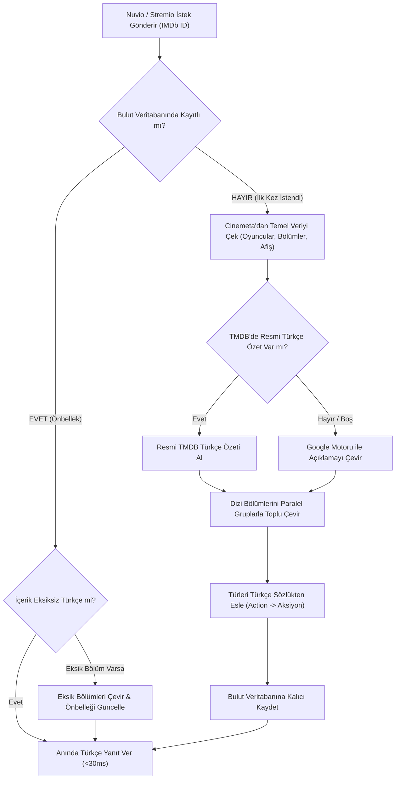

# Turkify 🇹🇷

> **Stremio** ve **Nuvio** için film, dizi ve bölüm açıklamalarını otomatik Türkçe'ye çevirip sunan, akıllı bulut önbellekli ve TMDB destekli yüksek performanslı açık kaynak meta eklentisi.

---

## 🌟 Öne Çıkan Özellikler

- **Otomatik Türkçe Çeviri**: Film ve dizi konularını, türlerini (Aksiyon, Gerilim, Bilim Kurgu vb.) ve tüm sezonluk tekil bölüm özetlerini akıcı Türkçe olarak sunar.
- **Akıllı Bulut Önbellekleme**: Bir kez çevrilen veya doğrulanan içerikler kalıcı olarak bulut veritabanına kaydedilir; sonraki tüm sorgularda çeviri beklemesi yaşanmadan `<30ms` hızla anında yanıt verilir.
- **TMDB 4K Görseller & Zengin Oyuncu Kadrosu**: Cinemeta'nın düşük çözünürlüklü görselleri yerine TMDB'nin (The Movie Database) resmi 4K afişlerini, sinematik arka planlarını ve fotoğraflı oyuncu profillerini sunar.
- **Uygulama İçi Hassas Arama**: Nuvio ve Stremio arama çubuğuna bir içerik yazıldığında TMDB arama algoritmasıyla harfiyen doğru sonuçlar Türkçe katalog üzerinden listelenir.
- **Torrent & Akış Eklentileriyle %100 Uyum**: Orijinal IMDb kimliklerini (`tt...`) korur ve isteğe bağlı olarak orijinal İngilizce başlıkları saklama imkanı tanır. Bu sayede Torrentio, MediaFusion, Comet ve Debrid eklentileriyle kaynak bulma kusursuz çalışır.
- **Ayraçlı Paralel Bölüm Çevirisi**: Çok sezonlu dizilerin tüm bölümlerini optimize edilmiş gruplar halinde paralel çevirerek hız sınırlarına takılmadan saniyeler içinde tamamlar.
- **Sıfır Yapılandırma & Ücretsiz**: Herhangi bir zorunlu anahtar, ücret veya karmaşık ayar gerektirmeden doğrudan kullanılabilir.

---

## 🔄 Mimari ve Çalışma Akışı

Turkify, gelen her istekte akıllı bir hiyerarşi izleyerek içeriği en hızlı ve en doğru şekilde kullanıcıya ulaştırır:



---

## 🚀 Kurulum

### Stremio
1. [`https://turkify-addon.vercel.app`](https://turkify-addon.vercel.app) adresini ziyaret edin.
2. **"Stremio'ya Otomatik Ekle"** butonuna tıklayın (veya doğrudan [`stremio://turkify-addon.vercel.app/manifest.json`](stremio://turkify-addon.vercel.app/manifest.json) bağlantısını açın).
3. Stremio uygulamasında **Yükle (Install)** butonuna basarak kurulumu tamamlayın.

### Nuvio (Android TV / Google TV / Mobil)
1. Eklenti manifest bağlantısını kopyalayın:
   ```text
   https://turkify-addon.vercel.app/manifest.json
   ```
2. Nuvio uygulamasını açıp **Ayarlar > İçerik & Keşif > Eklentiler (Addons)** sekmesine gidin.
3. Eklenti ekleme alanına kopyaladığınız bağlantıyı yapıştırıp kaydedin.
4. **Önemli Sıralama İpucu**: Eklentinin Cinemeta tarafından ezilmemesi ve Türkçe verilerin öncelikli gelmesi için Turkify'ı eklenti listesinde **en üst sıraya** taşıyın.

---

## ⚙️ Eklenti Özelleştirme

Kullanıcılar [`https://turkify-addon.vercel.app/configure`](https://turkify-addon.vercel.app/configure) adresi üzerinden eklentiyi ihtiyaçlarına göre özelleştirebilir:

1. **Orijinal Başlıkları Koru (`keepOriginalTitle`)**: Dizi ve film isimlerini orijinal dilde (İngilizce) bırakarak torrent ve debrid eklentileriyle kaynak eşleşmesini en üst seviyede tutar (Önerilen).
2. **Bölüm Açıklamalarını Çevir (`translateEpisodes`)**: Dizi bölümlerinin tekil konu özetlerini Türkçe olarak sunar (Önerilen).
3. **Gelişmiş Görsel ve Oyuncu Detayları (`enrichTmdbMedia`)**: TMDB'den yüksek çözünürlüklü 4K posterler, arka planlar ve fotoğraflı oyuncu kadrosunu dahil eder (Önerilen).
4. **Popüler İçerik Katalogları (`enableCatalogs`)**: Ana sayfaya Türkçe açıklamalı Popüler Filmler ve Popüler Diziler keşif vitrinlerini ekler (Önerilen).

---

## 🛠️ Kullanılan Teknolojiler ve Altyapı

- **Web ve Sunucu Altyapısı**: [Next.js 14](https://nextjs.org/) (App Router, TypeScript)
- **Arayüz ve Tasarım**: [Tailwind CSS](https://tailwindcss.com/)
- **Veritabanı ve Önbellek**: [Supabase](https://supabase.com/) (PostgreSQL Cloud Cache)
- **Film ve Dizi Veri Kaynağı**: [The Movie Database (TMDB)](https://www.themoviedb.org/) & [Cinemeta](https://stremio.com/)
- **Barındırma ve Bulut Dağıtım**: [Vercel](https://vercel.com/) Edge & Serverless
- **İkon Seti**: [Lucide React](https://lucide.dev/)

---

## 💻 Yerel Geliştirme ve Test

```bash
# Depoyu klonlayın
git clone https://github.com/brsbrkctn/Turkify.git
cd Turkify

# Bağımlılıkları yükleyin
npm install

# Testleri çalıştırın
npm test

# Geliştirme sunucusunu başlatın
npm run dev

# Üretim derlemesi alın
npm run build
```

---

## 📄 Lisans

Bu proje [MIT Lisansı](LICENSE) kapsamında lisanslanmıştır.
