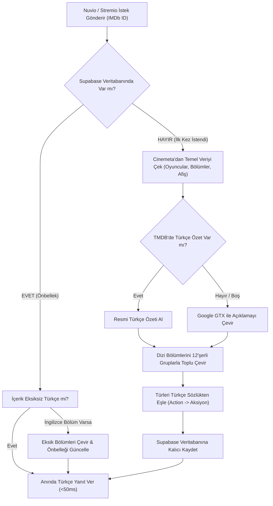

# Turkify 🇹🇷

> **Stremio** ve **Nuvio** için film, dizi ve bölüm açıklamalarını otomatik Türkçe'ye çevirip sunan, Supabase önbellek destekli yüksek performanslı meta eklentisi.

---

## 🌟 Özellikler

- **Otomatik Türkçe Çeviri**: Film ve dizi konularını, türlerini (Aksiyon, Gerilim, Bilim Kurgu vb.) ve sezon/bölüm özetlerini akıcı Türkçe olarak sunar.
- **Ayraçlı Toplu Çeviri (Delimiter Batching)**: Bölümleri 12'şerli gruplarla tek bir HTTP isteğinde birleştirerek Google Translate hız sınırlarına (HTTP 429) takılmadan saniyeler içinde çevirir.
- **Supabase PostgreSQL Önbelleği**: Bir kez çevrilen içerik kalıcı olarak veritabanına kaydedilir; sonraki tüm sorgularda çeviri API'si kullanılmadan `<30ms` hızla yanıt verilir.
- **Uygulama İçi Arama Desteği**: Nuvio ve Stremio arama çubuğuna bir içerik yazıldığında doğrudan Turkify kataloğu üzerinden Türkçe sonuçlar listelenir.
- **Torrent & Akış Uyumluluğu**: Orijinal IMDb ID'leri (`tt...`) ve orijinal İngilizce başlıkları korur; Torrentio, Comet, KnightCrawler gibi eklentilerin kaynak bulmasını asla engellemez.
- **Zengin Meta ve Oyuncu Kadrosu**: Cinemeta ve TMDB entegrasyonu ile tam oyuncu fotoğrafları, yönetmenler, fragmanlar ve afişler korunur.
- **Sıfır Yapılandırma & Ücretsiz**: Herhangi bir ücretli API veya zorunlu anahtar gerektirmez.

---

## 🔄 Mimari ve Çalışma Mantığı

Turkify, gelen her istekte akıllı bir hiyerarşi izleyerek içeriği en hızlı ve en doğru şekilde kullanıcıya ulaştırır:



---

## 🚀 Kurulum

### Stremio
1. `https://turkify-addon.vercel.app` adresini ziyaret edin.
2. **"Stremio'ya Otomatik Ekle"** butonuna tıklayın (veya `stremio://turkify-addon.vercel.app/manifest.json` bağlantısını açın).
3. Stremio üzerinden **Install (Yükle)** butonuna basın.

### Nuvio (Android TV / Google TV / Mobil)
1. Eklenti manifest bağlantısını kopyalayın:
   ```text
   https://turkify-addon.vercel.app/manifest.json
   ```
2. Nuvio uygulamasını açıp **Ayarlar > İçerik & Keşif > Eklentiler (Addons)** sekmesine gidin.
3. Eklenti ekleme alanına yukarıdaki bağlantıyı yapıştırıp kaydedin.
4. Eklenti listesinde **Turkify'ı en üst sıraya** taşıyın.

---

## 🇬🇧 English Documentation

### Overview
A high-performance, open-source metadata provider addon for **Stremio** and **Nuvio** that automatically delivers Turkish titles, overviews, genres, and episodic summaries for movies and TV series with persistent Supabase caching.

### Tech Stack
- **Framework**: [Next.js](https://nextjs.org/) (App Router, TypeScript)
- **Styling**: [Tailwind CSS](https://tailwindcss.com/)
- **Database & Cache**: [Supabase](https://supabase.com/) (PostgreSQL)
- **Deployment**: [Vercel](https://vercel.com/) Serverless
- **Icons**: [Lucide React](https://lucide.dev/)

### Environment Variables (Optional)
```env
NEXT_PUBLIC_SUPABASE_URL=https://your-project.supabase.co
SUPABASE_SERVICE_ROLE_KEY=your_service_role_or_anon_key
TMDB_API_KEY=your_optional_tmdb_v3_api_key
```

### Local Testing
```bash
npm install
npm test
npm run build
```

---

## 📄 Lisans
MIT License.
